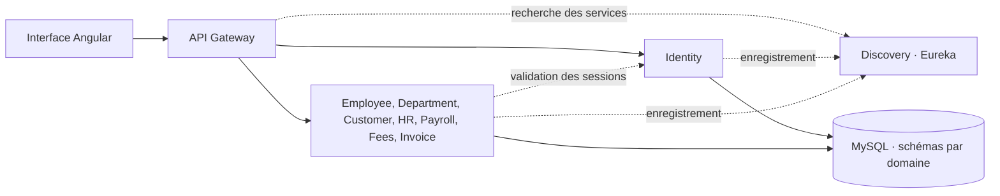

# CRM Workspace

CRM Workspace est un projet de stage d’ingénierie qui réunit le suivi commercial, les ressources humaines et la gestion financière dans une application web. Chaque profil dispose d’un espace adapté à ses responsabilités, de la consultation de factures par un client à l’administration des comptes et des dossiers RH.


*Aperçu illustratif de l’interface, issu de la page d’accueil du projet.*

## Fonctionnalités

- **Relation client** — fiches et classification des contacts, affectation aux employés, suivi des opportunités et échanges avec les clients.
- **Devis et facturation** — devis, conversion en facture, documents PDF, enregistrement de paiements et préparation de relances.
- **Organisation et RH** — employés, départements, congés et soldes, présences, formations, contrats, évaluations, recrutement et documents RH partagés.
- **Paie et honoraires** — préparation et publication des bulletins, consultation personnelle, suivi des règlements et cycles d’honoraires.
- **Pilotage et administration** — tableaux de bord selon le rôle, annuaire paginé, gestion des comptes, paramètres d’affichage et journal d’administration.

## Architecture

Le projet a évolué d’un backend Spring Boot monolithique vers des services organisés par domaine. Angular adresse l’API Gateway, qui route les appels vers les services enregistrés dans Eureka. Les services métier utilisent des schémas MySQL distincts sur l’instance du Compose local. Le code historique reste disponible dans [`backend/`](backend/).



| Service | Responsabilité | Port |
| --- | --- | ---: |
| Discovery | Registre Eureka | 8761 |
| Gateway | Entrée HTTP et routage vers les services | 8080 |
| Identity | Authentification, sessions et administration des comptes | 8082 |
| Employee | Annuaire et dossiers des employés | 8083 |
| Department | Référentiel des départements | 8084 |
| Customer | Contacts, opportunités et demandes clients | 8085 |
| HR | Congés, présences, formations, contrats, évaluations et dossier RH | 8086 |
| Payroll | Bulletins, publication et règlements de paie | 8087 |
| Fees | Honoraires et cycles de prestations | 8088 |
| Invoice | Devis, factures, paiements, relances et PDF | 8089 |

La bibliothèque [`common-security`](microservices/common-security/) mutualise la validation JWT et la vérification de l’état des comptes et des sessions pour les services qui l’utilisent.

## Technologies

Java 21, Spring Boot, Spring Cloud Gateway, Eureka, Spring Security et Maven côté backend. Angular 20, TypeScript, RxJS et Angular Material côté frontend. MySQL 8 et Flyway pour les données et leurs migrations, avec H2 dans les suites de tests configurées pour cette base. Docker Compose orchestre l’environnement local et Jenkins décrit la chaîne de compilation et de validation.

## Sécurité

Identity émet des jetons d’accès JWT liés à une session. Le renouvellement fait tourner le jeton de rafraîchissement. La déconnexion, le changement de mot de passe et les changements sensibles du compte déclenchent la révocation des sessions concernées. Les services vérifient les droits côté serveur et les espaces personnels limitent l’accès aux données du compte authentifié.

| Rôle | Accès principal |
| --- | --- |
| `SUPER_ADMIN` | Administration transverse, audit, gestion des comptes et modules métier |
| `ADMIN` | Administration des modules métier et gestion des comptes dans les limites de ses permissions |
| `EMPLOYEE` | Profil, congés, documents partagés, évaluations, bulletins publiés et contacts affectés |
| `CLIENT` | Coordonnées, factures et paiements enregistrés, demandes et échanges personnels |

## Installation locale

Prérequis pour les commandes ci-dessous sous Bash ou Git Bash. Utiliser Git, un JDK 21, Maven 3.9, Node.js 22.12+ dans la série 22 ou Node.js 24, npm et Docker avec Compose. Chrome ou Chromium est requis pour les tests Angular.

```bash
git clone --branch microservices https://github.com/SendesniMaram/CRM.git
cd CRM
cp .env.example .env
```

Renseigner `MYSQL_ROOT_PASSWORD` et `APP_JWT_SECRET` dans `.env`. Utiliser des valeurs propres à l’environnement local et un secret JWT aléatoire d’au moins 32 octets. Les Dockerfiles copient les JAR déjà compilés. Construire la bibliothèque, puis les services depuis la racine.

```bash
mvn -B -ntp -f microservices/common-security/pom.xml install
for service in discovery gateway identity employee department customer hr payroll fees invoice; do
  mvn -B -ntp -f "microservices/${service}-service/pom.xml" package || exit 1
done
docker compose config --quiet
docker compose up -d --build
docker compose ps
```

Dans un autre terminal, depuis la racine du dépôt :

```bash
cd frontend
npm ci
npm start
```

Ouvrir [l’application](http://localhost:4200). L’API Gateway est accessible sur [localhost:8080](http://localhost:8080) et Eureka sur [localhost:8761](http://localhost:8761). Le Compose de base est destiné au réseau de développement local.

Pour initialiser un premier compte d’administration sur une base de développement, Identity fournit un bootstrap explicite sous le profil `local` ou `dev`. Le profil et les propriétés `APP_BOOTSTRAP_ADMIN_ENABLED`, `APP_BOOTSTRAP_ADMIN_USERNAME`, `APP_BOOTSTRAP_ADMIN_EMAIL` et `APP_BOOTSTRAP_ADMIN_PASSWORD` se transmettent au conteneur via une configuration Compose locale. Le premier accès impose un changement de mot de passe. Les procédures de démonstration documentent la préparation d’un environnement dédié. [Démo Express](scripts/deployment/express/README.md) · [Démo native](scripts/deployment/native-demo/README.md)

## Tests et validation

| Vérification de la version intégrée | Résultat |
| --- | --- |
| Maven `verify` sur les dix services, `common-security` et le backend historique | 1 749 tests réussis |
| Angular sous Chrome Headless | 1 302 tests réussis |
| Build Angular de production | Réussi, avec des avertissements de taille et de projection d’icônes |
| Outils CI et sondes de disponibilité | 26 tests réussis |
| Docker Compose | Validation statique réussie. Le daemon était indisponible pour cette campagne en exécution. |

Pour relancer les tests frontend :

```bash
cd frontend
npm run test:ci
npm run build -- --configuration production
```

Les commandes Maven par module et les prérequis de l’agent CI sont détaillés dans le [guide Jenkins](scripts/ci/README.md).

## DevOps et perspectives

Le [Compose de base](docker-compose.yml) définit les services, MySQL et les volumes locaux. Le [Jenkinsfile](Jenkinsfile) configure la compilation, les tests et l’archivage des rapports, avec une chaîne dédiée à l’intégration continue. Le dépôt contient aussi une configuration GitHub Actions.

Les images par service, les migrations et la configuration externalisée constituent une base pour préparer une cible Kubernetes. Les perspectives comprennent l’écriture et la validation des manifestes sur un cluster, la gestion centralisée des secrets, l’observabilité et une recette de déploiement de bout en bout. La version présentée est validée par la campagne locale de compilation et de tests ci-dessus.

## Auteur

**Maram Sendesni** · Projet de stage CRM.
