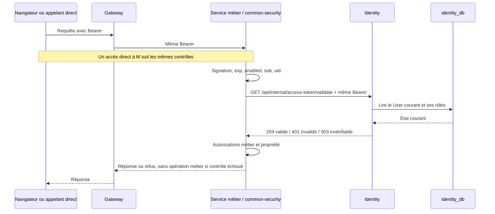

# Sprint 1B — Plan de sécurisation des access tokens JWT

> Archive documentaire : les constats, chiffres, anciens commits et autorisations ci-dessous décrivent la campagne datée du rapport. Ils ne constituent pas un état courant ni un plan à réappliquer sur `publication-clean`. Toute opération réelle nécessite une nouvelle vérification et l’autorisation adaptée.

Date : 18 octobre 2026, Africa/Tunis. Projet : CRM, branche `microservices`.

Référence de validation consolidée : [SPRINT1B_LOT_F_REVIEW.md](SPRINT1B_LOT_F_REVIEW.md).

## Mise à jour documentaire — 22 octobre 2026

Le plan initial ci-dessous reste daté ; les sources locales comprennent désormais la validation centralisée et le principal typé. Le contrat à préserver est : signature et claims strictement validés localement, puis confirmation Identity par HTTP 204 ; refus 401 pour un jeton ou compte invalide, 503 lorsque la validation est impossible, sans exécution métier ni fallback local. L'expiration est revérifiée après confirmation. `uid` est une chaîne décimale positive canonique représentable par Long ; aucun identifiant Employee n'en est déduit. Les autorités proviennent des rôles signés, sans élévation ; `Authentication.getName()` conserve le username.

La configuration `app.security.account-validation` impose une origine explicite et des délais bornés : connexion 500 ms, lecture 1 s, budget global 1,5 s par défaut. Le transport n'accepte ni redirection ni proxy système. L'exécuteur autorise quatre tâches simultanées sans file ; saturation, interruption et dépassement du budget échouent avec 503. Une opération DNS non interruptible peut finir ultérieurement, sans authentifier une requête déjà refusée. Aucun cache positif ni nouvelle tentative applicative ne dispense du contrôle courant.

Gateway protège le chemin interne avant routage et après réécriture ; les services conservent leurs contrôles directs. Les tests isolés ne constituent pas une validation des images actives. Toute reprise exige des images compatibles avec ces contrôles, une vérification des schémas avec `validate`/initialisation désactivée et une validation E2E autorisée. Ne pas reprendre les anciens séquencements MVP comme procédure actuelle. Les conditions de rotation et de reprise sans secret compromis restent dans [CRM_SECRET_ROTATION_READINESS.md](CRM_SECRET_ROTATION_READINESS.md). Changer la clé JWT ne révoque pas les refresh tokens persistés.

**VERDICT : READY FOR IMPLEMENTATION — plan prêt à être approuvé, aucune implémentation effectuée.** Les décisions de disponibilité, de transition des anciens JWT et de réactivation doivent être validées avant le développement. Elles ne bloquent pas la formulation d'une solution technique sans migration MySQL.

## 1. Décision recommandée

Conserver la validation cryptographique locale, puis faire vérifier **à chaque requête protégée et dans chaque service métier** le jeton et l'état courant du compte par Identity. Ne pas mettre en cache les validations positives. En cas de doute ou d'indisponibilité, empêcher l'exécution de l'opération métier.

La recommandation comprend :

- Un endpoint Identity de validation du **Bearer présenté lui-même**, sans recherche libre d'un autre utilisateur.
- Un client HTTP partagé par les sept services, fourni par `common-security`, sans Redis, broker ou nouvelle base.
- HTTP **401** si le jeton/compte est invalide ; **503** si la vérification est impossible ; **403** seulement pour une permission métier insuffisante après authentification valide.
- Un claim signé `uid` contenant l'identifiant User stable déjà existant, en conservant `sub=username` pour la compatibilité des congés. Ce claim n'est ni Employee.id ni Customer.id.
- Une livraison coordonnée et une période de transition explicite des anciens JWT sans `uid`.

**Garantie visée :** après le commit d'une désactivation/verrouillage, toute nouvelle vérification d'accès sur un service mis à jour consulte l'état courant d'Identity et refuse le compte inactif. Les ports directs et les appels interservices suivent la même règle que les appels via Gateway. Les opérations déjà validées/en cours ne peuvent pas être annulées rétroactivement par un filtre HTTP.

Cette solution contrôle l'état courant ; elle ne constitue pas une liste de révocation permanente de chaque access token. Après réactivation, un ancien JWT encore valide peut redevenir utilisable. Si cette propriété n'est pas acceptable, une version de sécurité persistée devient un complément nécessaire (§9).

## 2. Situation actuelle vérifiée dans les sources

### 2.1 Chaîne de confiance

| Composant | État observé | Conséquence |
|---|---|---|
| Gateway | `spring-cloud-starter-gateway`, Eureka, routes explicites et discovery locator ; aucun filtre JWT ni dépendance Spring Security/common-security identifié dans son module | Routage et CORS ; pas de contrôle central actuel du statut |
| Identity | Validation signature/expiration/enabled ; relecture du User ; refus disabled/locked/introuvable ; résolution stricte par username depuis Sprint 1 | État courant contrôlé localement sur Identity |
| Sept services métier | Filtre servlet `JwtAuthenticationFilter` de common-security, installé avant `UsernamePasswordAuthenticationFilter` ; autorisations par SecurityConfig | Signature/expiration/enabled/sujet contrôlés ; rôles issus des claims, sans relecture Identity |
| JWT | `sub`, email, enabled, roles, iat, exp ; durée d'une heure | Les claims sont une photographie de l'émission ; aucun uid ou numéro de session persistant |
| Refresh | Stockage Identity, rotation et contrôle d'état corrigés au Sprint 1 | N'invalide pas à lui seul un JWT déjà signé dans un service autonome |
| Compose | Ports métier 8083–8089 et Identity 8082 publiés ; réseau `crm-network` | Un contrôle Gateway seul ne couvre pas les accès directs |
| Appels internes | Employee→Department transmet Authorization par Feign ; HR→Identity/Employee utilise DiscoveryClient et RestClient avec propagation du Bearer | La protection doit aussi être appliquée aux requêtes reçues d'un autre service |
| Frontend | L'intercepteur tente un refresh sur 401 ; ne le déclenche pas sur 503 | Le statut d'erreur doit distinguer panne et session invalide |

Les sources locales comprennent les corrections Sprint 1 non commitées. Ce plan ne vérifie pas les images réellement actives et ne prétend pas que ces corrections sont déployées.

### 2.2 Fichiers probants

- `microservices/gateway-service/pom.xml`, `src/main/resources/application.yml` et inventaire de `src/main/java/` : Gateway réactive et routage, discovery locator actif.
- `microservices/common-security/src/main/java/com/crm/security/{JwtService,JwtAuthenticationFilter,JwtSecurityAutoConfiguration,RestAuthenticationEntryPoint}.java` et `pom.xml` : validation locale, filtre servlet et dépendances disponibles.
- `microservices/identity-service/src/main/java/com/crm/identity/security/{JwtService,JwtAuthenticationFilter,CustomUserDetailsService}.java`, `config/SecurityConfig.java` : état courant et résolution du sujet.
- Dans ce même service : `controller/AuthenticationController.java`, `service/impl/AuthenticationServiceImpl.java`, `repository/{UserRepository,RefreshTokenRepository}.java`, `entity/User.java` : points d'émission, flags, id et révocation des refresh tokens.
- Les sept `config/SecurityConfig.java` métier, leurs POM et `docker-compose.yml` : dépendance commune, rôles et exposition des services.
- `microservices/hr-service/src/main/java/com/crm/hr/client/LeaveDirectoryClient.java` et `microservices/employee-service/src/main/java/com/crm/employee/client/DepartmentClientConfiguration.java` : propagation du Bearer.
- `frontend/src/app/core/interceptors/auth.interceptor.ts` : traitement 401/403/503.

### 2.3 Défaut restant

Modifier `users.enabled` ou `users.account_non_locked` ne modifie pas un JWT déjà émis. Un jeton signé enabled=true reste accepté par common-security tant qu'il n'a pas expiré, même si Identity refuserait son propriétaire.

Le partage du secret HMAC ne permet pas d'apprendre un changement de statut ; il permet seulement de vérifier la signature. Révoquer un refresh token ne met pas non plus les services métier au courant.

## 3. Comparaison des quatre solutions

Les appréciations de performance sont des propriétés de conception, pas des mesures réalisées sur ce CRM.

| Solution | Sécurité et délai de prise en compte | Performance | Complexité / dépendances | Compatibilité CRM / MySQL | Panne d'Identity |
|---|---|---|---|---|---|
| **1. État courant centralisé, sans cache positif** | Refus à chaque nouvelle vérification après le commit du statut ; couvre suppression et retrait de rôles si inclus au contrat ; pas d'annulation des opérations déjà parties | Un aller-retour et une lecture d'identité par requête protégée et par service traversé | Modérée : endpoint, client HTTP, erreurs et délais bornés ; aucune nouvelle infrastructure | Réutilise Identity, Spring Web et réseau Compose ; aucune migration pour flags/id existants | Refus sûr 503 pour toute opération nécessitant le contrôle ; dépendance forte de disponibilité |
| **2. Révocation distribuée** | Peut rendre les anciens jetons définitivement invalides par jti ou date de révocation ; propagation à garantir ; un événement perdu ne doit pas laisser un accès valide | Lecture d'un registre partagé par requête, ou cache local avec fenêtre de propagation | Élevée : registre durable/Redis ou table, expiration des entrées, événements/outbox ou consultation ; restauration et synchronisation | Possible en Compose, mais ajoute des composants et procédures ; pas de registre/jti actuel | Si le registre fiable reste accessible, contrôle possible sans Identity ; sinon refus sûr. Un registre local vide après redémarrage n'est pas une preuve de validité |
| **3. Version de session/sécurité** | Comparaison d'une version signée à la version courante ; invalide définitivement tous les anciens jetons après incrément, même après réactivation | Il faut malgré tout consulter la version courante, ou accepter le délai d'un cache | Modérée avec Identity centralisé ; plus forte si version distribuée ; changement atomique flags/version/révocations | Colonne `security_version` ou nouvel état durable à ajouter ; migrations requises dans le modèle actuel | Sans source courante accessible, refus sûr ; une version dans le JWT seul ne résout rien |
| **4. Durée d'accès plus courte** | Réduit seulement la fenêtre ; un compte désactivé garde l'accès jusqu'à exp ; ne satisfait pas seul le besoin de coupure au prochain contrôle | Pas d'appel réseau métier supplémentaire ; davantage de refresh et écritures Identity | Faible ; pas de nouvelle infrastructure ni migration | Très compatible mais changement de durée à aligner et tester | Les JWT restent utilisables jusqu'à exp ; après expiration, plus de renouvellement si Identity indisponible |

**Choix : solution 1**, avec identifiant stable dans le JWT, sans cache positif. La solution 3 est une extension cohérente si la réactivation ne doit jamais restaurer les anciens access tokens. La solution 4 peut compléter la défense plus tard ; elle ne remplace pas le contrôle courant. La solution 2 n'est pas justifiée ici par un besoin démontré de volumétrie ou de disponibilité indépendante.

Ne pas utiliser `User.updatedAt` comme version de sécurité improvisée : toute édition de profil peut le changer, et sa précision/conversion temporelle ne fournit pas un contrat de révocation fiable.

## 4. Architecture cible proposée

La Gateway ne reçoit pas le filtre servlet common-security : son module est réactif, tandis que la bibliothèque fournit une chaîne servlet. Il n'est pas nécessaire d'ajouter une seconde introspection à la Gateway. Elle relaie le Bearer, les 401/403/503 et les corps d'erreur ; les services restent responsables de l'accès final.

### 4.1 Endpoint Identity proposé

**`GET /api/internal/access-token/validate`**, chemin proposé et non existant aujourd'hui.

| Élément | Contrat proposé |
|---|---|
| Authentification | Le même `Authorization: Bearer <access-token>` que la requête d'origine ; JWT vérifié par Identity, compte relu en base |
| Autorisation | Accessible à tout rôle authentifié dont le compte/jeton est valide ; pas de rôle ADMIN exigé pour cette auto-vérification |
| Entrée | Aucun userId/username/email/token cible dans l'URL ou le corps ; pas de contrôle d'un compte choisi librement par l'appelant |
| Succès | **204**, sans corps, uniquement après tous les contrôles |
| Refus définitif | **401**, message générique, pour token invalide/expiré, compte inconnu/disabled/locked, uid incompatible ou droits signés retirés |
| Vérification impossible | **503**, erreur générique, pour panne DB ou dépendance interne empêchant la lecture du compte |
| Effets de bord | Aucun refresh consommé/émis, aucune écriture de compte, aucun jeton révoqué par ce GET |
| Cache | `Cache-Control: no-store` ; aucun cache positif applicatif ni intermédiaire |
| Données retournées | Aucun nom/email/rôle/id de tiers ; aucune liste d'utilisateurs ; aucun token dans les logs |

Ne pas placer cet endpoint sous `/api/auth/**` : ce préfixe est actuellement `permitAll`. Ajouter une règle spécifique et testée dans Identity SecurityConfig. Le filtre Identity ne doit pas appeler cet endpoint lui-même : il utilise directement son repository et sa politique locale, ce qui évite une récursion réseau.

Le Bearer est une preuve de possession pour **sa propre** vérification ; il ne constitue pas une authentification d'application appelante. Cela évite un nouveau secret partagé sans ouvrir une recherche administrative. Le réseau ne doit permettre que le trafic prévu ; l'endpoint n'est pas une garantie d'identité de service. Si une future exigence impose une authentification mutuelle des services, prévoir mTLS ou une identité de service dans un lot distinct.

### 4.2 Identité stable et rôles

- Ajouter à l'émission Login **et** Refresh un claim signé `uid` = User.id, sous forme de chaîne décimale positive canonique. Le générer depuis le User authentifié chargé en base, jamais depuis une valeur libre de la requête.
- Conserver `sub=username`, enabled, roles, iat et exp ; ne pas remplacer le subject par Employee.id ou Customer.id.
- Identity résout le compte par uid, vérifie sa présence et la cohérence avec le username signé. Une suppression/recréation du même username ne doit pas rattacher l'ancien jeton au nouveau compte.
- La politique de validation compare les rôles signés normalisés aux rôles courants : si un rôle signé a été retiré, refuser le JWT et imposer un renouvellement/une reconnexion. Un nouveau rôle en base ne doit pas être ajouté aux autorités d'un service métier par une simple réponse d'introspection.
- common-security conserve la construction des autorités depuis les claims signés ; les permissions de ses SecurityConfig et les contrôles de propriété métier restent inchangés.
- Le claim uid n'est pas une association User–Employee–Customer : les liens métier restent hors de ce sprint.

L'actuel Login émet le JWT dans `AuthenticationController` à partir de `LoginResponse`, qui ne transporte pas encore User.id. L'implémentation devra faire remonter l'id authentifié par un résultat interne ou un champ interne non sérialisé, puis l'utiliser à l'émission. Le refresh dispose déjà du User. Ne pas déduire l'id d'une recherche approximative ou d'un email après authentification.

### 4.3 Contrôle partagé dans les sept services

Ordre attendu dans `JwtAuthenticationFilter` :

1. Préserver les exemptions **exactes** de ressources publiques convenues : health minimal, API de diagnostic publique existante, docs si leur publication est maintenue. Elles n'accèdent pas aux données métier ; aucun préfixe métier entier n'est exempté.
2. Sur une route protégée, rejeter un Bearer absent/invalide selon la chaîne de sécurité existante. Signature/exp/enabled/sub/uid sont contrôlés localement avant tout appel réseau.
3. Faire un seul appel de validation Identity pour cette requête, avec le Bearer d'origine et une destination configurée de confiance.
4. Accepter **uniquement** le statut 204 attendu. Recontrôler l'expiration avant de construire l'Authentication si le délai réseau a pu dépasser exp.
5. Sur 401 Identity : retourner 401 au client, sans exécuter la chaîne métier. Sur erreur de disponibilité/protocole : retourner 503, sans authentification de secours.
6. Après succès, construire les mêmes autorités qu'aujourd'hui, puis laisser Spring Security et les services appliquer rôles et propriété. Un 204 ne transforme jamais EMPLOYEE/CLIENT en administrateur.

Les erreurs du client de validation doivent être gérées dans le filtre : elles ne sont pas nécessairement couvertes par un `@RestControllerAdvice`. Utiliser un format JSON stable de type ApiError sans jeton ni détail de DB, et des codes d'erreur distinguant session invalide et vérification indisponible.

### 4.4 Réseau, adressage et délais

Pour le Compose actuel à une instance Identity, privilégier une URL fixe configurée par environnement : `http://identity-service:8082` sur le réseau Compose ; `http://localhost:8082` pour une exécution locale hors Docker. C'est une proposition de configuration non sensible, sans modification de `.env` ni ajout de secret.

- Appeler Identity **directement**, jamais via Gateway : pas de boucle et pas de dépendance à son routage public.
- Le client HTTP est créé une fois par application ; pas de construction à chaque requête. RestClient/Spring Web est déjà disponible dans common-security ; aucun starter de discovery supplémentaire n'est nécessaire pour le choix Compose.
- Ne jamais construire l'hôte ou le chemin depuis un claim, un header de l'appelant ou un paramètre métier. Ne pas suivre les redirections ; ne pas transmettre le Bearer à un autre hôte.
- Valeurs initiales à mesurer/valider : connexion **500 ms**, lecture **1 s**, budget total visé **1,5 s** par vérification, sans nouvelle tentative automatique. Vérifier aussi le bornage de la résolution DNS et de l'attente de connexion ; des timeouts socket seuls ne prouvent pas le budget total.
- Aucun cache de succès, aucun fallback « JWT local valide donc autoriser », aucun mode dégradé permissif. Un éventuel circuit breaker ultérieur ne peut que refuser plus vite avec 503, jamais réutiliser un succès ancien.
- Ne pas fournir un défaut localhost silencieux en environnement Docker : URL manquante/invalide doit empêcher le démarrage sécurisé plutôt que contourner le contrôle.
- L'HTTP interne actuel suppose le réseau Compose de confiance. En production, protéger aussi ce transport par TLS et valider les certificats ; ne pas contourner leur vérification. Le traitement de secrets/certificats éventuels sera autorisé séparément.

## 5. Indisponibilités et sémantique HTTP

| Situation | Résultat du service métier | Traitement |
|---|---|---|
| JWT absent, falsifié, expiré, uid absent en mode strict | 401 | Aucun appel Identity nécessaire pour un rejet local certain |
| Identity confirme un compte inactif/inconnu ou un JWT incompatible | 401 | Aucun handler métier appelé ; le frontend peut tenter son refresh habituel, qui doit aussi refuser un compte inactif |
| Compte vérifié mais droit métier insuffisant | 403 | Pas de refresh provoqué par cette décision de rôle/propriété |
| DNS, connexion refusée, timeout, TLS invalide | 503 | Opération bloquée, erreur générique, aucun résultat ancien réutilisé |
| Identity indisponible / DB Identity indisponible | 503 | Opération bloquée ; pas de 401 fabriqué qui provoquerait des refresh et déconnexions injustifiés |
| Réponse Identity 3xx, 200 inattendu, 403, 404, 429 ou 5xx | 503 | Contrat non satisfait, aucun suivi de redirection ; diagnostiquer la configuration/charge côté exploitation |
| Endpoint health public sans Bearer | Politique publique existante | Ne dépend pas de la réussite de l'introspection d'un utilisateur |

Le frontend actuel ne tente pas de refresh sur 503 : comportement à conserver et à tester. Ne pas transformer toutes les erreurs d'Identity en « session expirée ». Les PDF ne doivent pas retourner 200 avec un fichier d'erreur ; 401/403/503 gardent une réponse d'erreur identifiable.

La réponse 503 d'un appel interservice protégé doit rester un échec identifiable. Examiner en particulier `LeaveDirectoryClient` et le fallback Feign Employee→Department : une panne de validation ne doit pas être présentée comme un département simplement absent. Aucune donnée déjà lue en amont ne doit permettre de poursuivre une écriture sensible après le refus d'une dépendance nécessaire.

## 6. Impacts et risques

### Disponibilité et charge

Chaque service touché devient dépendant d'Identity et de sa base pour ses accès protégés. La panne d'Identity rend ces opérations indisponibles : c'est le choix de sécurité demandé, à accepter explicitement.

Pour une requête traversant N services protégés, prévoir N validations Identity, et non une seule validation à la Gateway. Employee→Department, par exemple, ajoute deux contrôles à la chaîne externe. Ne pas transmettre un header « déjà validé » comme dispense : il serait falsifiable sans mécanisme de confiance spécifique.

Mesurer le débit et les temps p50/p95/p99, le nombre d'appels d'introspection, les connexions, threads servlet, pools DB et délais d'erreur. Les index sur User.id et username existent dans le modèle. L'absence de cache positif évite le délai de révocation ; elle ne dispense pas de dimensionner Identity. Les garanties nécessitent une lecture de l'état courant sur la source d'autorité, sans réplique en retard ni cache JPA/applicatif partagé obsolète.

### Limites de la garantie

- Une opération admise juste avant le changement de statut peut finir après son commit. Une annulation des requêtes en vol ou un contrôle atomique distribué au commit métier ne fait pas partie de ce filtre.
- Réactiver un compte peut rendre de nouveau valide son ancien JWT non expiré : une version persistée de sécurité est nécessaire pour interdire cela définitivement.
- Sans commande atomique de statut, un aller-retour disabled→enabled peut aussi laisser subsister des refresh tokens non présentés pendant la période inactive. Le futur service de changement de statut doit révoquer les refresh tokens dans la même transaction et coordonner les courses avec Login/Refresh.
- Les secrets HMAC sont partagés entre services : un service compromis qui détient la clé peut forger un JWT. L'introspection avec uid et comparaison des rôles limite certaines incohérences, mais ne résout pas cette compromission de l'émetteur. Une signature asymétrique serait une évolution distincte.
- La garantie reste incomplète pendant une livraison partielle où des services exécutent encore l'ancienne bibliothèque.
- La mise en cache des résultats dans un proxy, un navigateur ou un autre service réintroduirait une fenêtre d'accès ; elle est explicitement exclue pour la validation.

### Gateway et exposition

Conserver ses routes métier et la transmission Authorization. L'endpoint interne n'a pas besoin de route publique explicite. Toutefois le **discovery locator actif** peut créer une autre URL vers Identity : l'absence de route explicite ne suffit pas à le cacher.

Prévoir un refus du chemin interne sur les chemins routés explicites et discovery, y compris après réécriture du chemin, avec tests de toutes les variantes. Ce blocage doit rester réactif et séparé du filtre servlet. La sécurité de l'endpoint repose malgré tout sur la validation du Bearer lui-même ; le masquage n'est pas une authentification.

Le retrait des ports hôte internes peut renforcer le réseau lors d'une livraison approuvée, mais ne constitue pas un prérequis logique pour tester la protection : celle-ci doit fonctionner même avec un accès direct à un service. Aucun port n'est modifié par ce plan.

## 7. Plan d'implémentation et fichiers concernés

Les noms des nouveaux composants sont proposés ; aucun n'est créé dans ce sprint de planification.

| Lot | Fichiers à modifier/créer | But et critères |
|---|---|---|
| A — Politique Identity | `microservices/identity-service/src/main/java/com/crm/identity/security/JwtService.java`, `JwtAuthenticationFilter.java`, `CustomUserDetailsService.java` ; nouveau `security/AccessTokenValidationService.java` | Validation signature/expiration/uid/sub/état/rôles ; repository local, aucune introspection réseau récursive ; réponses 401/503 maîtrisées |
| A — Contrat interne | Nouveau `controller/AccessTokenValidationController.java`, `config/SecurityConfig.java`, traitement d'erreurs Identity | GET interne protégé pour tous les rôles actifs, 204/no-store ; aucune API de lecture arbitraire de statut |
| B — Émission uid | `controller/AuthenticationController.java`, `service/impl/AuthenticationServiceImpl.java`, `dto/LoginResponse.java` ou nouveau résultat interne de login, méthodes d'émission JWT | uid authentifié sur Login et Refresh ; contrats JSON frontend préservés ; ne pas changer les durées ni renouvellement correct du Sprint 1 |
| C — Client partagé | Dans `microservices/common-security/src/main/java/com/crm/security/` : nouveaux `AccountValidationClient.java`, `AccountValidationProperties.java`, types de résultat/erreur ; `JwtSecurityAutoConfiguration.java` | Destination fixe validée, client unique, timeouts bornés, pas de retry/cache positif, distinction invalide/indisponible |
| C — Filtre et réponses | `JwtAuthenticationFilter.java`, `JwtService.java`, `RestAuthenticationEntryPoint.java`, éventuellement nouveau composant de réponse 503 | Vérifier avant de créer Authentication et avant le handler métier ; ne pas dépendre d'un advice MVC pour les exceptions du filtre |
| D — Services consommateurs | `microservices/{employee,department,customer,hr,payroll,fees,invoice}-service/src/main/resources/application.yml`, leurs SecurityConfig si nécessaire, tests et configuration Maven de consommation | Activation obligatoire ; URL/délais configurés ; aucune route sensible exemptée ; droits et contrôles propriétaire conservés |
| D — Dépendances internes | `employee-service/.../client/DepartmentClientFallbackFactory.java`, `hr-service/.../client/LeaveDirectoryClient.java` et handlers concernés si nécessaire | Propager correctement l'indisponibilité de sécurité, sans fallback trompeur ni poursuite d'une opération exigeant les données distantes |
| E — Gateway | `microservices/gateway-service/src/main/resources/application.yml` ; composant réactif de blocage des routes internes si nécessaire ; tests de routage | Empêcher l'exposition du chemin interne via routes explicites/discovery ; ne pas ajouter common-security servlet au POM Gateway |
| E — Compose | `docker-compose.yml` ou surcharge non sensible dédiée de déploiement | Fournir l'URL interne aux sept services ; disponibilité/readiness vérifiée ; ne pas confondre depends_on et disponibilité garantie |
| F — Régression frontend | Specs d'intercepteur, AuthService et téléchargement PDF | Confirmer 401→refresh borné, 503 sans refresh/logout et erreur PDF lisible ; aucun espace personnel nouveau |
| F — Exploitation | Documentation, tests E2E isolés et vérification d'images | Livraison atomique ou interruption contrôlée, panne Identity, accès direct, rollback et absence de secret dans les logs |

Le POM common-security dispose déjà de Spring Web ; aucune bibliothèque d'introspection dédiée n'est nécessaire à priori. Confirmer la configuration du client HTTP et les délais par tests lors de l'implémentation. Les POM des sept consommateurs doivent utiliser le nouveau JAR, même si sa version reste SNAPSHOT ; reconstruire la bibliothèque ne met pas à jour les images déjà lancées.

### Ordre et transition des anciens jetons

1. Après approbation, implémenter et tester le contrat Identity et l'émission uid, puis le client/filtre commun et les consommateurs sur un environnement isolé.
2. Préparer une livraison coordonnée : Identity capable d'émettre uid et endpoint interne disponible avant l'activation du contrôle obligatoire dans les services. Vérifier que les chemins Login/Refresh restent accessibles sans appeler l'endpoint interne depuis Identity.
3. En mode strict, un ancien access token sans uid reçoit 401. Le refresh existant peut émettre un nouveau JWT avec uid si le compte et le refresh token sont toujours valides. Sinon la reconnexion est nécessaire ; aucune association ne doit être devinée pour sauver une session ancienne.
4. Tester la transition automatique 401→refresh du frontend et l'absence de boucle. Accepter une reconnexion pour les clients qui n'ont pas de refresh utilisable. Ne pas conserver indéfiniment un mode de compatibilité qui validerait uniquement sub.
5. Mettre à jour tous les services avant d'annoncer la protection distribuée. Si une mise à jour progressive est nécessaire, prévoir un créneau d'indisponibilité ou une restriction de trafic qui empêche l'accès aux anciennes instances ; la sécurité n'est pas complète pendant un mélange non maîtrisé.
6. Retour arrière : documenter que revenir à l'ancienne bibliothèque rétablit la fenêtre d'une heure. Préférer une interruption contrôlée plutôt qu'un rollback permissif présenté comme équivalent en sécurité. Ne pas réactiver automatiquement les accès si Identity ne peut pas être vérifié.

Une activation obligatoire doit échouer au démarrage sur configuration absente/invalide. Les tests peuvent injecter un client simulé explicitement ; un bean manquant ou un profil mal configuré ne doit jamais créer un client autorisant tout en production.

## 8. Tests à prévoir et critères d'acceptation

Tous les tests ci-dessous sont **à développer/exécuter après autorisation**. Aucun n'a été exécuté pour ce plan. Les 461 tests du Sprint 1 sont un historique, pas une preuve de ce futur mécanisme.

| Niveau | Cas | Attendu |
|---|---|---|
| Identity, unitaires | Signature, expiration, enabled, uid canonique, correspondance uid/sub, rôle retiré | 204 seulement pour un jeton valide et un compte actif ; refus des entrées incohérentes |
| Identity, intégration H2 | Émettre le jeton, commiter disabled/locked hors transaction de test, réutiliser exactement le même jeton | 401 à la validation suivante, sans émission/consommation de refresh par le GET |
| Identity, intégration | Supprimer un compte puis recréer le même username avec un autre id ; confusion username/email ; uid d'une autre personne | Ancien jeton refusé ; aucun rattachement au nouveau compte |
| Identity, permissions | ADMIN, SUPER_ADMIN, EMPLOYEE et CLIENT actifs ; même endpoint avec rôle non-admin | Les quatre peuvent valider leur propre jeton ; pas d'accès à un compte arbitraire |
| Émission et compatibilité | Login et Refresh ; JWT ancien sans uid ; compte inactif avec refresh | Nouveau claim correct ; transition par refresh pour compte actif ; inactif refusé ; réponses JSON frontend conservées |
| common-security, client HTTP simulé | 204, 401, 403/404/429/5xx, 200 inattendu, redirection vers autre hôte, réponse lente | Autoriser seulement 204 ; refus/503 selon contrat ; pas de transmission du Bearer à un tiers |
| common-security, filtre actif | Mauvaise signature/exp/uid ; échec réseau ; jwt expirant pendant l'appel ; absence de client/configuration | Rejet local ou 503 ; handler métier et repository métier jamais appelés après échec ; démarrage sécurisé refusé si mal configuré |
| Non-régression des droits | Rôles administratifs, refus employé/client sur CRUD globaux, retrait de rôle, accès propres aux congés | Aucune élévation, aucun contrôle propriétaire supprimé, aucun droit nouveau sur Paie/Facture |
| Sept services, intégration | Même JWT avant/après désactivation et verrouillage ; accès via Gateway et par port direct | Refus sur chaque service après le commit, y compris détail et PDF ; ne pas se limiter à Employee |
| Interservices | Employee→Department, HR→Identity/Employee ; panne Identity au deuxième contrôle | Échec identifiable, pas d'écriture sensible qui exige une dépendance refusée ; aucune récursion d'introspection |
| Gateway, tests réactifs | Passage Authorization/401/403/503 ; blocage endpoint interne par routes explicites/discovery et variantes réécrites | Aucun chemin de contournement Gateway ; service direct toujours protégé |
| Panne et reprise isolées | Identity arrêté/DB indisponible, DNS faux, timeout, récupération ; aucune valeur cache préalablement acceptée | 503 dans le budget prévu ; pas de lecture/écriture métier ; après reprise, nouvelle lecture du statut, pas de succès périmé |
| Concurrence | Changement de statut pendant requête, Login/Refresh simultanés, appel déjà validé | Garantie au point de vérification explicitée ; pas de promesse d'annulation rétroactive ; politique de commande de statut testée |
| Réactivation | disabled→enabled et locked→unlocked avec ancien JWT encore valide | Résultat conforme à la politique approuvée : revalidation possible dans le plan sans version, ou refus définitif si extension versionnée retenue |
| Frontend/PDF | 401 puis refresh refusé, 503 réseau, 403 métier, refus d'un PDF | Pas de boucle refresh, pas de logout provoqué par 503, message d'erreur sans faux PDF |
| Charge / confidentialité | Débit, p95/p99, appels par chaîne, pools/threads, traces et logs en erreur | Charge soutenable mesurée ; timeouts bornés ; aucun Bearer, mot de passe ou réponse personnelle dans les logs |
| MySQL isolé | Lecture du statut après commit et cohérence transactionnelle, si campagne autorisée | Pas de statut périmé dû à une réplique/cache ; validation du futur changement atomique sans toucher les bases actives |

Les tests unitaires avec client HTTP simulé confirment le code, pas le réseau réel. La validation E2E finale exige un environnement séparé, des comptes synthétiques, et une autorisation de démarrage/arrêt/modification de ces seules données de test.

## 9. Migrations et décisions nécessitant autorisation

### Sans migration pour la solution retenue

Les flags enabled/account_non_locked, User.id et les rôles existent déjà. Le claim uid et l'endpoint de validation ne nécessitent ni table ni colonne. Le changement du format JWT requiert en revanche une politique de transition/reconnexion.

Si la revue exige une invalidation **définitive** des jetons antérieurs, même après réactivation, proposer ensuite une migration additive `users.security_version BIGINT NOT NULL DEFAULT 0` : incrément atomique avec le statut et la révocation des refresh tokens, claim signé comparé à la valeur courante. Ce n'est pas une migration prête à lancer : types, baseline, backfill des JWT, rollback et tests MySQL doivent être spécifiés et approuvés séparément. Ne pas réutiliser les migrations d'associations du Sprint 1 pour cela.

### Décisions à approuver avant implémentation/livraison

| Décision | Proposition retenue dans ce plan | Effet à accepter |
|---|---|---|
| Autorisation de développer | Identity + common-security + configurations et tests consommateurs/Gateway décrits au §7 | Ce document seul ne donne pas cette autorisation |
| Disponibilité | Validation à chaque requête, sans cache positif ; refus 503 si invérifiable | Identity et sa DB deviennent une dépendance de tous les accès protégés |
| Point de coupure | Refus aux vérifications après commit ; requêtes déjà admises peuvent finir | Pas d'annulation distribuée des opérations en cours |
| Anciennes sessions | Ajouter uid, mode strict avec refresh/reconnexion des JWT sans uid | Certaines sessions doivent renouveler leur access token ou se reconnecter |
| Réactivation | Contrôle d'état courant sans registre permanent ; extension versionnée si refus définitif exigé | Un ancien access token non expiré peut redevenir utilisable après réactivation sans version |
| Rôles retirés | Refuser le JWT dont un rôle signé n'est plus attribué ; ne pas enrichir les rôles depuis l'introspection | Renouvellement/reconnexion possible après modification de rôle |
| Délais | 500 ms connexion / 1 s lecture, budget total à éprouver | À ajuster sur mesures sans introduire de fallback permissif |
| Endpoint interne et transport | Accès auto-vérifié par Bearer, réseau de confiance, pas de route publique ; TLS en production | Pas de nouveau secret applicatif ; mTLS/identité de service reste une évolution distincte |
| Exécution de tests E2E | Environnement isolé avec données synthétiques et panne simulée | Autorisation explicite avant création de données, arrêt de services ou tests authentifiés réels |
| Livraison | Reconstruction coordonnée et redémarrage approuvé des seuls composants nécessaires | Aucun redémarrage autorisé par ce sprint de planification |
| Migration optionnelle | Aucune pour le plan de base ; version de sécurité seulement après approbation dédiée | Aucune modification MySQL ou `.env` à ce stade |

## 10. Résultat de cette phase de planification

Le seul livrable créé est ce fichier. Les sources et configurations ont été consultées sans exécution de tests, d'appels API, de commandes Docker ou SQL. Aucun code, secret, `.env`, volume ou conteneur n'est modifié ; aucun commit ni push.

Le relevé d'empreintes des fichiers déjà modifiés/non suivis sert à contrôler que le plan préserve l'état de travail, y compris les corrections Sprint 1. Le résultat d'une implémentation future devra être examiné séparément avant toute livraison.

**VERDICT FINAL : READY FOR IMPLEMENTATION**, sous réserve d'approbation des choix du §9. Recommandation : validation centralisée du Bearer et du compte dans chaque service, sans cache positif et avec refus sûr ; aucun ajout de dépendance distribuée ou migration MySQL n'est nécessaire pour cette première protection.
